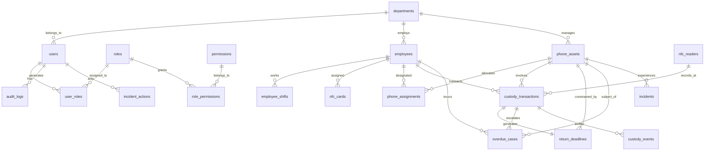

# Enterprise Architecture Specification: Company Phone Tracker (CPT)
**Phase 1: Architecture, Foundation & UI/UX**

## 1. System Overview & Domain Design
Company Phone Tracker (CPT) is an enterprise-grade mobile asset custody platform designed for real-time tracking, assignment, and custody lifecycle management of company-issued cellular phones using employee NFC smart badges.

The platform provides a dual operational paradigm:
1. **High-Throughput Turnstile Kiosk:** A streamlined interface inspired by modern attendance kiosk simplicity, enabling employees to tap their NFC smart card at entry/exit gates to rapidly check out or surrender shift devices.
2. **Enterprise Asset Custody Dashboard:** A comprehensive management control center for Asset Custodians, Department Supervisors, IT Support, and Compliance Auditors to monitor fleet availability, manage inventory, track return deadlines, escalate overdue breaches, and review immutable audit trails.

---

## 2. Technology Stack & Installed Versions

| Technology / Library | Version | Architecture Role |
|---|---|---|
| **Node.js** | `v24.20.0` | Server runtime environment |
| **Next.js (App Router)** | `15.5.27` | Full-stack framework, SSR, RSC, and Edge Middleware |
| **React / React-DOM** | `19.3.0` | UI component tree with Server & Client components |
| **TypeScript** | `5.9.3` | Strict type definitions across models and routes |
| **PostgreSQL** | `16.x Compatible` | Relational database engine |
| **Prisma ORM** | `5.22.0` | Database schema modeling, migrations & query client |
| **Tailwind CSS** | `3.4.19` | Utility-first responsive design system with CSS tokens |
| **PostCSS / Autoprefixer** | `8.5.29 / 10.6.1` | CSS compilation and cross-browser vendor prefixing |
| **Zod** | `3.25.76` | Server-side runtime request validation |
| **bcryptjs** | `2.4.3` | Pure JavaScript bcrypt credential hashing (zero native compile dependencies) |
| **jose** | `5.10.0` | Web Crypto API HMAC-SHA256 JWT session tokens |
| **Lucide React** | `0.475.0` | Accessible SVG iconography |
| **clsx / tailwind-merge** | `2.1.1 / 3.7.0` | Conditional class composition |

---

## 3. Normalized Database Schema (22 Core Tables)

The database schema enforces third normal form (3NF) and strict referential integrity across 22 normalized tables:



### Relational Decoupling Guarantees
1. **Permanent Employee Record (`employees`):** Primary key is an immutable UUID. Physical NFC card UIDs are **never** used as employee primary keys.
2. **Employee NFC Credential (`nfc_cards`):** Modeled as an independent table referencing `employee_id`. When a card is lost, damaged, or replaced, the existing card is revoked and a new card enrolled without destroying or modifying the employee profile.
3. **Standing Phone Assignment (`phone_assignments`):** Establishes policy designation (dedicated device vs. rotational pool) separate from physical custody.
4. **Daily Custody Transactions (`custody_transactions`):** Logs the actual physical check-out (issuance) and check-in (surrender) events. Each transaction captures the NFC card UID, reader identifier, operator user ID, device condition, timestamp, and return deadline. Card replacement and phone reassignment preserve 100% of historical custody logs.

---

## 4. Application Architecture & Route Layout

```
src/
├── app/
│   ├── (dashboard)/               # Authenticated route group (Protected by layout & middleware)
│   │   ├── layout.tsx             # Shared DashboardShell (Sidebar + Header + ThemeProvider)
│   │   ├── dashboard/page.tsx     # 1. Operational Command Center & Metrics
│   │   ├── employees/page.tsx     # 2. Permanent Employee Directory & Shifts
│   │   ├── nfc-cards/page.tsx     # 3. NFC Smart Card Registry & Credential Binding
│   │   ├── phones/page.tsx        # 4. Company Phone Hardware Inventory
│   │   ├── assignments/page.tsx   # 5. Standing Device-to-Person Designations
│   │   ├── kiosk/page.tsx         # 6. High-Throughput NFC Attendance Kiosk
│   │   ├── custody/
│   │   │   ├── active/page.tsx    # 8. Active In-Possession Fleet Monitor
│   │   │   ├── operations/page.tsx# 7. Desk Issuance & Surrender Operations
│   │   │   └── page.tsx           # Redirects to /custody/active
│   │   ├── overdue/page.tsx       # 9. Overdue Monitoring & Shift Breach Tracker
│   │   ├── incidents/page.tsx     # 10. Damage, Loss & Hardware Defects
│   │   ├── reports/page.tsx       # 11. Compliance Reports & CSV/PDF Exports
│   │   ├── audit-logs/page.tsx    # 12. Immutable Compliance Audit Trail
│   │   ├── users/page.tsx         # 13. User Accounts & Role Administration
│   │   └── settings/page.tsx      # 14. System Configuration & Reader Settings
│   ├── api/
│   │   └── auth/
│   │       ├── login/route.ts     # Rate-limited authentication & JWT cookie issuance
│   │       ├── logout/route.ts    # Session destruction & audit logging
│   │       └── me/route.ts        # Current session verification endpoint
│   ├── login/page.tsx             # Enterprise Login Portal (Suspense-wrapped)
│   ├── unauthorized/page.tsx      # 403 Forbidden Access Boundary Violation
│   ├── globals.css                # CSS variables, dark/light theme tokens
│   └── layout.tsx                 # Root layout with HTML/Body wrapper
├── components/
│   ├── ui/card.tsx                # Accessible Card primitives
│   ├── dashboard-shell.tsx        # Layout scaffold
│   ├── sidebar.tsx                # Responsive 14-module navigation drawer
│   ├── header.tsx                 # Top app bar with user role, search, status, theme toggle
│   ├── empty-state.tsx            # Clean zero-data empty state component
│   ├── loading-state.tsx          # Data-fetching spinner component
│   ├── placeholder-page.tsx       # Standardized unfinished module showcase
│   └── theme-provider.tsx         # Dark / Light theme context & localStorage sync
├── lib/
│   ├── auth.ts                    # bcryptjs, jose JWT sessions, cookie handlers
│   ├── db.ts                      # PrismaClient singleton with pgbouncer support
│   ├── rbac.ts                    # Role definitions, route access rules, permission helper
│   ├── rate-limit.ts              # Sliding-window brute force login defense
│   └── audit.ts                   # Immutable audit log writer
├── middleware.ts                  # Next.js Edge Middleware for RBAC route enforcement
```

---

## 5. Security & Authentication Architecture
1. **Password Hashing:** Passwords hashed with salt factor 10 using `bcryptjs`.
2. **Session Tokens:** Cryptographically signed HMAC-SHA256 JWT tokens with 8-hour shift expiration, containing user ID, role code, department ID, and permission codes.
3. **Secure Cookies:** Delivered via `HttpOnly`, `SameSite=Lax`, and `Secure` (production) cookies under name `cpt_session`.
4. **Brute Force Defense:** In-memory sliding window rate limiter locks accounts/IPs after 5 consecutive failed attempts for 15 minutes.
5. **Server-Side Enforcement:** Route protection enforced at Next.js Edge Middleware before request reaches page renderers. Secondary verification occurs in Server Components and API route handlers.
6. **Audit Trail:** Every login, logout, lockout, access violation, and administrative provision is logged to `audit_logs`.
