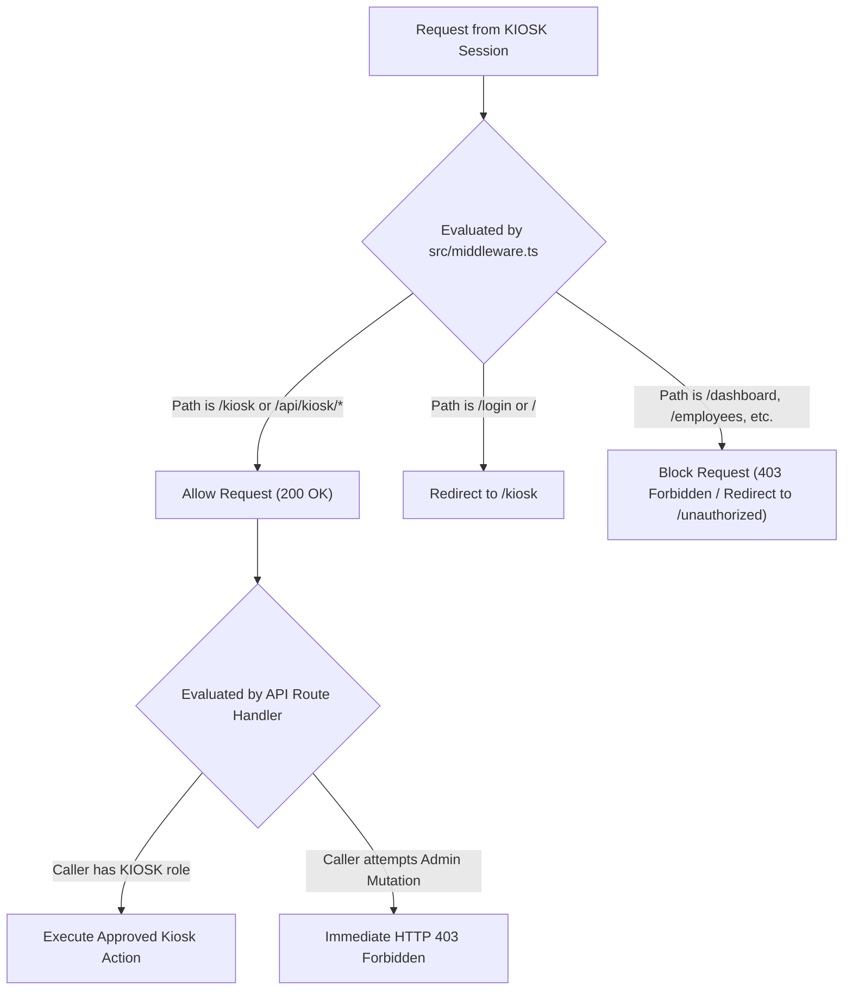

# Kiosk Account Setup & Security Boundary Guide

**Document Version:** 1.0.0  
**Target Audience:** System Administrators, Security Engineers, DevOps  
**System:** Company Phone Tracker — Mobile Asset Custody Platform

---

## 1. Overview of the Dedicated KIOSK Role

To enforce the principle of least privilege, kiosk stations operate under a specialized `KIOSK` user role. Unlike administrative or custody desk accounts, a kiosk terminal requires zero operational access to employee records, financial asset values, user administration, or reporting metrics.

### Role Characteristics
* **Role Code:** `KIOSK`
* **Role Name:** Kiosk Terminal Account
* **Primary Identifier:** `PHONE-KIOSK-01`
* **Default Routing:** Direct redirect to `/kiosk` upon authentication.
* **Administrative Privileges:** **None** (zero read/write access to administrative endpoints).

---

## 2. Granular Permission Mapping

| Permission Code | Description | `KIOSK` Role Granted? |
| :--- | :--- | :--- |
| `kiosk:access` | Access the self-service kiosk turnstile UI (`/kiosk`) | **Yes** |
| `kiosk:resolve` | Resolve scanned NFC tag to asset and employee details | **Yes** |
| `kiosk:request` | Initiate short-lived Time In / Time Out verification tokens | **Yes** |
| `kiosk:status` | Poll pending request approval status from desk queue | **Yes** |
| `employees:read` | View employee directory and details | **No** (HTTP 403) |
| `employees:write`| Create or edit employees | **No** (HTTP 403) |
| `phones:read` | View phone inventory and serials | **No** (HTTP 403) |
| `phones:write` | Create or decommission phone assets | **No** (HTTP 403) |
| `users:read` | View system user accounts and roles | **No** (HTTP 403) |
| `reports:export` | Export CSV, Excel, or PDF audit logs | **No** (HTTP 403) |

---

## 3. Provisioning `PHONE-KIOSK-01` via Admin API

Kiosk terminals are provisioned securely by an authorized System Administrator without embedding static credentials in browser scripts.

### Automated Provisioning Script
Administrators can run the automated provisioning script:
```powershell
node scripts/seed-kiosk-account.mjs
```

### Direct Admin Provisioning Endpoint
Alternatively, an administrator can provision a terminal dynamically via the authenticated API:

```bash
POST /api/kiosk/provision
Content-Type: application/json
Cookie: cpt_session=<ADMIN_SESSION_COOKIE>

{
  "kioskCode": "PHONE-KIOSK-01",
  "location": "Main Depot Lobby Central Turnstile",
  "readerIdentifier": "KIOSK-GATE-A"
}
```

#### API Response
```json
{
  "success": true,
  "kioskDevice": {
    "kioskCode": "PHONE-KIOSK-01",
    "location": "Main Depot Lobby Central Turnstile",
    "status": "ONLINE"
  },
  "user": {
    "email": "phone-kiosk-01@company.local",
    "role": "KIOSK"
  },
  "sessionToken": "eyJhbGciOiJIUzI1NiIs..."
}
```
The endpoint sets the secure, encrypted `cpt_session` cookie directly on the kiosk browser with the `HttpOnly`, `SameSite=Lax`, and `Secure` attributes enabled.

---

## 4. RBAC Enforcement & Route Boundaries

Access boundaries are enforced at both middleware and server-side route handler layers:



### Verification Evidence
During automated penetration testing (`scripts/test-kiosk-time-in-out.mjs` Scenario 16):
* Attempt to access `GET /api/users` with Kiosk session -> **HTTP 403 Forbidden**
* Attempt to access `GET /api/employees` with Kiosk session -> **HTTP 403 Forbidden**
* Attempt to navigate to `/dashboard` with Kiosk session -> **Redirected to `/unauthorized`**

---

## 5. Session Maintenance, Recovery & Emergency Lockout

### 1. Remote Terminal Lockout (`Kiosk under maintenance`) & Not-Provisioned Page
If a physical kiosk terminal needs to be placed in maintenance or locked out remotely:
1. Log into the System Administrator console at `/admin/kiosks`.
2. Locate the terminal (e.g. `PHONE-KIOSK-01`) and set its status to `MAINTENANCE` or `DISABLED`.
3. **Immediate Maintenance Lock on Tap**: When a card is tapped while the device is not `ACTIVE`, `POST /api/kiosk/resolve` returns HTTP `503 KIOSK_MAINTENANCE`. The kiosk immediately displays the full-screen **"Kiosk under maintenance"** (`I18N.EN` / `I18N.FIL`) lock overlay instead of a generic error.
4. **Automatic Re-check & Redirection**: While the maintenance lock is shown, the kiosk re-checks every 30 seconds via `POST /api/kiosk/keepalive` (and polls `/api/kiosk/config` status):
   - If the administrator re-enables the terminal (`status = "ACTIVE"`), the maintenance lock clears automatically and the terminal returns to the idle turnstile screen without requiring manual intervention.
   - If `keepalive` returns HTTP `403` (`DEVICE_INACTIVE`), the browser redirects to `/api/kiosk/device-login`, which clears the session cookie and redirects to `/kiosk/not-provisioned?reason=device_inactive`.
5. **Not-Provisioned / Inactive Screen (`/kiosk/not-provisioned`)**: Displays why the terminal is inactive (`missing_key`, `invalid_key`, `device_inactive`, or `unavailable`) and automatically retries `/api/kiosk/device-login` (every 10s when `unavailable` or `device_inactive`, or every 30s otherwise) so the terminal recovers hands-free once provisioned or re-activated.

### 2. Full-Screen Offline Overlay (`/api/health` Monitoring)
- The kiosk page polls `GET /api/health` every 10 seconds.
- If the server is unreachable or `checks.database.status !== "UP"` continuously for **30 seconds or more**, a full-screen **"Temporarily unavailable – please wait"** (`"Pansamantalang hindi magagamit – mangyaring maghintay"`) overlay is shown.
- While the overlay (or maintenance lock) is active, any card tap plays the warning chime and displays **"Please wait and tap again"** (`"Mangyaring maghintay at i-tap muli"`) so taps are never lost silently.
- As soon as `/api/health` reports `checks.database.status === "UP"`, the overlay clears automatically without a page reload.

### 3. Touch-Free NFC Maintenance Card Diagnostics
- System Administrators (`SYSTEM_ADMIN`) can mark a dedicated NFC card with `isMaintenanceCard = true` on `/admin/nfc-cards`.
- Tapping a maintenance card at `/kiosk` does **not** create a custody transaction; instead, it logs a `KIOSK_MAINTENANCE_CARD_TAP` audit event and opens a **30-second System Diagnostics screen** showing live Reader status, Agent status, DB/Health status, Last Backup time, App Version, `KIOSK_CODE`, Server Time, and Tap Queue length.
- Tapping the maintenance card a second time while the 30-second diagnostics screen is open triggers `window.location.reload()` immediately (a `Reload` button is also available if a touchscreen is attached).

### 4. Continuous Error / Offline Self-Heal & Clock Drift Check
- **Self-Reload**: If the kiosk remains in a continuous error or offline state for more than **10 minutes**, it calls `window.location.reload()` to recover from stale browser or asset state. The last reload timestamp is stored in `sessionStorage` (wrapped in `try/catch`) to guarantee it never reloads more than once per 10 minutes. (In non-production environments, `?selfHealMs=<ms>` can override the threshold for automated testing.)
- **Clock Drift Warning**: If the server timestamp returned by `/api/health` or `/api/kiosk/config` differs from the client clock by more than **2 minutes**, a non-blocking informational warning badge (`"Clock out of sync"` / `"Hindi tugma ang oras"`) is displayed in the kiosk header.

