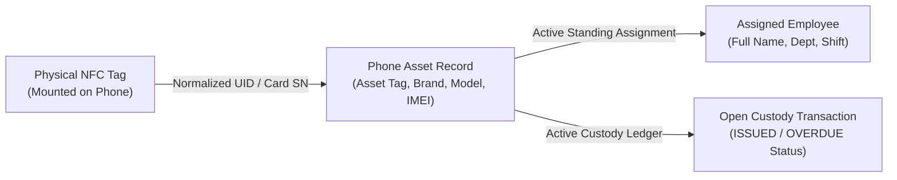
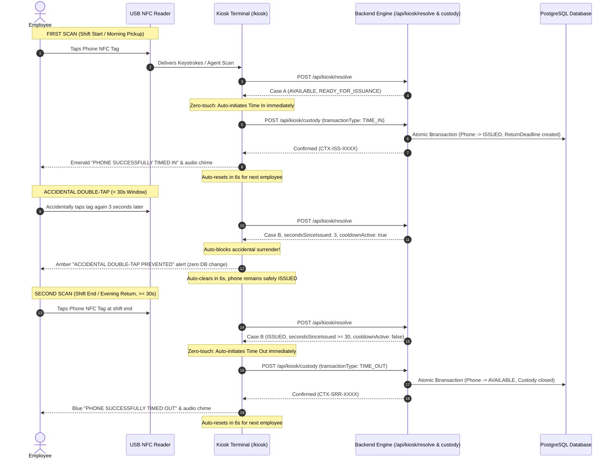

# Company Phone NFC Time In / Time Out System — Technical Implementation Guide

**Document Version:** 1.0.0  
**Target Platform:** Company Phone Tracker (CPT) Enterprise Mobility Custody Platform  
**Architecture:** Next.js 15 (App Router), TypeScript, PostgreSQL, Prisma ORM, Web NFC Bridge  
**Kiosk Identifier:** `PHONE-KIOSK-01` | **Port:** `http://localhost:5000/kiosk`

---

## 1. System Objective & Architecture Overview

The **Company Phone NFC Time In / Time Out System** is an enterprise-grade custody management platform designed to track the daily physical movement and accountability of company-issued mobile assets. 

### Operational Definitions
* **TIME IN:** An employee receives or takes physical custody of their designated company phone asset at the start of their shift.
* **TIME OUT:** An employee surrenders or returns their designated company phone asset to depot custody at the end of their shift.

> **Important:** This system is **asset custody tracking**, strictly separate from human resource attendance tracking. Its sole responsibility is device whereabouts, custodian accountability, device physical health, and loss prevention.

### Architectural Inversion: Phone-Mounted NFC Tags
Unlike legacy systems that scan employee badges, the updated architecture utilizes physical NFC tags permanently mounted to each company-issued device:



1. **Tag Scanning:** The employee taps the NFC tag affixed to the back of the company phone onto the USB reader.
2. **Entity Resolution:** The server resolves `NfcCard -> PhoneAsset -> Active Assignment -> Employee`.
3. **Custody Evaluation:** The server checks whether the device is currently in depot (`AVAILABLE`) or checked out (`ISSUED`/`OVERDUE`).
4. **Intelligent Button Decision:** The server returns both `TIME IN` and `TIME OUT` buttons, dynamically enabling the valid action and disabling the invalid action with clear explanatory text.
5. **Direct PIN-Free Custody Execution:** Pressing the enabled button immediately and safely executes the custody transition, recording the reader, asset, employee, and timestamp without requiring a PIN or password.

---

## 2. Relational Schema & Database Inversion

To support phone-mounted NFC tags while maintaining 100% backward compatibility with earlier badge-based workflows, the `nfc_cards` schema was updated to establish a direct relation to `phone_assets`:

```prisma
model NfcCard {
  id              String         @id @default(uuid())
  cardUid         String         @unique @map("card_uid")
  cardNumber      String         @unique @map("card_number")
  identifierType  String         @default("MIFARE_CLASSIC") @map("identifier_type")
  readerSource    String?        @map("reader_source")
  
  // Legacy / Secondary badge linkage
  employeeId      String?        @map("employee_id")
  employee        Employee?      @relation(fields: [employeeId], references: [id])
  
  // Primary Architecture: Phone-Mounted NFC Tag
  phoneAssetId    String?        @map("phone_asset_id")
  phoneAsset      PhoneAsset?    @relation(fields: [phoneAssetId], references: [id])
  
  status          NfcCardStatus  @default(ACTIVE)
  enrolledAt      DateTime       @default(now()) @map("enrolled_at")
  enrolledByUserId String?       @map("enrolled_by_user_id")
  // ...
  @@map("nfc_cards")
}
```

### Relational Resolution Strategy
* If `card.phoneAssetId` exists: Resolve `phone = card.phoneAsset` -> find active `phoneAssignment` -> resolve `employee`.
* Fallback (if `card.employeeId` exists): Resolve `employee = card.employee` -> find active `phoneAssignment` -> resolve `phone`.
* If neither is assigned or card is `REVOKED`: Return Case E (`CASE_E_NOT_RECOGNIZED`) with strict data non-disclosure.

---

## 3. Intelligent Turnstile State Machine & Zero-Touch Execution

To ensure the fastest possible turnstile throughput, all manual screen button interactions during scanning have been eliminated. The kiosk operates as a zero-touch tap-and-go turnstile:

### State Machine Transition Rules

| Scan Event | Device State in DB | Elapsed Time Since Time In | Kiosk Action | Turnstile Transition |
| :--- | :--- | :--- | :--- | :--- |
| **1st Scan** (Shift Start) | `AVAILABLE` (In Depot) | N/A | **Automatic TIME IN** | Transfers custody to employee, records return deadline, transitions phone to `ISSUED`. |
| **Accidental Double-Tap** (< 30s) | `ISSUED` (In Custody) | `< 30 seconds` | **DOUBLE-TAP BLOCKED** | Blocks surrender, displays alert with elapsed/remaining seconds, plays warning chime. Zero DB mutation. |
| **2nd Scan** (Shift End / Return) | `ISSUED` (In Custody) | `>= 30 seconds` | **Automatic TIME OUT** | Closes custody, records return duration, resets phone status to `AVAILABLE`. |
| **Late Return** | `OVERDUE` | Any (Bypasses Cooldown) | **Automatic TIME OUT** | Closes overdue custody, reconciles overdue case, resets phone status to `AVAILABLE`. |
| **Unassigned Device** | `AVAILABLE` / `ISSUED` | N/A | **Warning Banner** | Advises employee that no active employee assignment exists for this phone. |
| **Unenrolled / Revoked Tag** | Any / Revoked | N/A | **Case E Non-Disclosure** | Displays generic *"Card not recognized"*; zero data leaked. |

---

## 4. Zero-Touch Automatic Tap-and-Go Sequence & Cooldown Architecture



### Operational Characteristics
1. **Zero Screen Touches:** Employees never need to touch the kiosk monitor; tapping the phone NFC tag alone drives the custody engine.
2. **Accidental Double-Tap Immunity:** A 30-second time differential prevents accidental immediate surrenders when an employee taps twice, shakes the phone over the reader, or hesitates at the turnstile.
3. **Instant Feedback:** Processing completes in ~200ms with distinct audio chimes for success (high-tone two-burst chime) and double-tap prevention (warning chime).
4. **Authoritative Overdue Processing:** Overdue devices bypass cooldowns, ensuring late returns are never impeded or locked out.
5. **Comprehensive Metadata Preservation:** Every event records kiosk identifier, employee identity, phone asset ID, timestamp, expected return deadline, and audit log entries.

---

## 5. Security & RBAC Enforcement Boundaries

The dedicated Kiosk Account (`PHONE-KIOSK-01`) is strictly sandboxed:
* **Role:** `KIOSK`
* **Permitted Routes:** `/kiosk`, `/api/kiosk/*`, `/api/health`
* **Blocked Routes:** Any attempt by a `KIOSK` session to access `/dashboard`, `/employees`, `/phones`, `/users`, `/reports`, or `/settings` triggers an immediate **HTTP 403 Forbidden** or redirection to `/unauthorized`.
* **Zero Credential Storage:** Terminal sessions are established via cryptographically signed tokens (`POST /api/kiosk/provision`). No administrator credentials exist on the terminal.
* **Strict Non-Disclosure:** Unknown, unregistered, or revoked tags return an identical generic error: *"Card not recognized. Please contact the assigned custodian."* Zero metadata regarding the asset or prior employee is leaked.

---

## 6. Daily Reconciliation & Reporting Terminology

Export engines (`src/lib/reports/engine.ts`) have been synchronized with Time In / Time Out custody terminology across all three standard formats (Excel XLSX, CSV, and PDF):

* **"Time In / Issued":** Timestamp when custody was transferred to employee.
* **"Time Out / Actual Return":** Timestamp when custody was returned to depot.
* **"NFC Tag Reference":** The physical tag UID bound to the mobile asset.
* **Formula Injection Sanitization:** Spreadsheet cells are automatically sanitized against CSV injection attacks (`=`, `+`, `-`, `@`).
