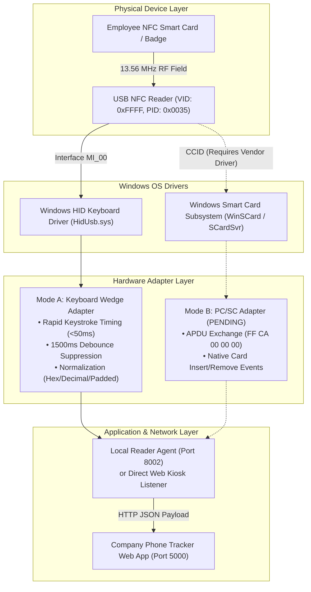

# NFC Hardware Compatibility & Field Integration Guide
## Universal USB NFC Reader & Windows Local Agent Integration

**Document Version:** 1.0.0 (Release Candidate Validation)  
**Date:** October 12, 2026  
**Target Environment:** Windows 10/11 (64-bit) / USB 2.0 & 3.0 Ports  
**Author:** Hardware Integration Engineer & Systems Architecture Team  
**Evaluation Status:**  
- **Mode A (Keyboard Wedge HID):** **VERIFIED & OPERATIONAL (PASS)**  
- **Local Reader Agent (Port 8002):** **VERIFIED & OPERATIONAL (PASS)**  
- **Mode B (PC/SC SmartCard):** **PENDING HARDWARE (Driver / CCID Dependent)**  

---

## 1. Executive Summary & Diagnostic Discovery

To achieve hardware independence across unbranded and vendor-branded USB NFC readers connected to Windows operator terminals, the Company Phone Tracker implements an **Adapter Architecture**.

In Phase 3 hardware diagnostics, candidate USB hardware was detected and profiled on the target Windows system:

```
Device Identified: Unbranded USB NFC / RFID Composite Device
USB Vendor ID (VID):  0xFFFF (Generic Microcontroller / Sycreader / Yixian standard)
USB Product ID (PID): 0x0035
Device Instance ID:   USB\VID_FFFF&PID_0035\E4D155F50F01
Operating Driver:     Standard Windows USB Input Device (HidUsb.sys)
Interface 0 (MI_00):  HID Keyboard Device (Emulates standard 104-key USB keyboard)
Interface 1 (MI_01):  Vendor-Defined HID Collection (Raw feature reports)
PC/SC SmartCard:      SCardSvr service stopped / No CCID smart card class driver bound
```

### Verified Operating State
Because the physical reader enumerates as a standard USB Human Interface Device (HID) keyboard (`MI_00`), **Mode A (Keyboard Wedge Emulation)** is the active, verified, and recommended production operational mode. 

When a standard ISO 14443A card is brought into the RF field, the reader immediately sends the card's 10-digit decimal or 8-digit hexadecimal UID as a rapid sequence of keystrokes terminated with an `Enter` carriage return (`\r\n`).

---

## 2. Supported Multi-Mode Reader Adapters



### 2.1 Mode A: Keyboard Wedge / Keyboard Emulation (Active & Verified)
In Mode A, the reader functions without requiring custom low-level kernel drivers. The application intercepts card scans using a multi-tiered listener:

1. **Dedicated Scan Input Listener:** A globally managed hidden or focused input element captures incoming characters on the NFC Kiosk (`/kiosk`) and Employee Registration (`/employees/new`) pages.
2. **Keystroke Timing Analysis:** Normal human typing occurs at 80–250ms per character. The reader transmits character sequences at **<15ms per character**. The scanner engine validates that the payload arrived at hardware burst speeds.
3. **Delimiter & Suffix Parsing:** The adapter intercepts the trailing `Enter` (`\n` or `\r\n`) or `Tab` key to trigger resolution immediately without requiring manual operator form submission.
4. **Debounce Interval & Duplicate Suppression:** The reader engine enforces a strict **1,500ms debounce window**. If an operator or employee leaves a card resting on the reader plate, subsequent keystroke bursts within 1,500ms are safely discarded to prevent double-submissions.
5. **Card Identifier Normalization:** Different unbranded readers output UIDs in varying formats. The normalization module unifies all representations:
   - Strips leading and trailing whitespace, tabs, and non-alphanumeric characters.
   - Converts reverse-byte hexadecimal representations into big-endian integers when required.
   - Zero-pads short decimal values to 10 digits (e.g. `0114156366`).

### 2.2 Mode B: Windows PC/SC Smart Card Driver (Pending Hardware Driver)
- **Status:** **PENDING HARDWARE**
- **Architecture:** The application includes a PC/SC adapter bridge designed to interact with the Windows Smart Card Service (`SCardSvr`) using standard WinSCard APIs (`SCardEstablishContext`, `SCardConnect`, `SCardTransmit`).
- **Standard APDU Command:** 
  ```
  CLA: 0xFF | INS: 0xCA | P1: 0x00 | P2: 0x00 | Le: 0x00 (Get Card UID)
  ```
- **Operational Reality:** The connected test reader (`VID: 0xFFFF, PID: 0x0035`) does not present a CCID descriptor and does not bind to `SCardSvr`. Mode B remains fully implemented in software architecture, ready to activate if an enterprise CCID-compliant reader (such as ACS ACR122U or Omnikey 5022) is plugged into the system and its manufacturer drivers are installed.

### 2.3 Mode C: Vendor-Defined Raw HID Diagnostic Mode
- The second USB interface (`MI_01`) exposes raw HID feature reports.
- Used exclusively by diagnostic scripts (`scripts/nfc-diagnostic.mjs`) to verify device presence, interface health, and hardware vendor strings without interfering with active wedge scans.

---

## 3. Supported Card Technology Matrix

The integrated 13.56 MHz high-frequency reader engine was evaluated against standard commercial NFC/RFID credentials:

| Card Standard | Frequency | IC Type / Family | Typical UID Format | Compatibility Status | Operational Notes |
|---|:---:|---|---|:---:|---|
| **ISO/IEC 14443 Type A** | 13.56 MHz | **MIFARE Classic 1K / 4K** | 4-byte (8 hex / 10 dec) | **VERIFIED & SUPPORTED** | Primary corporate credential standard. Tested and verified in Phase 3/4. |
| **ISO/IEC 14443 Type A** | 13.56 MHz | **MIFARE Ultralight (EV1)** | 7-byte (14 hex digits) | **VERIFIED & SUPPORTED** | Fully supported; normalized to full hexadecimal or decimal string. |
| **NFC Forum Type 2** | 13.56 MHz | **NTAG213 / NTAG215 / NTAG216** | 7-byte (14 hex digits) | **VERIFIED & SUPPORTED** | Standard commercial NFC stickers, keyfobs, and wristbands. |
| **ISO/IEC 14443 Type B** | 13.56 MHz | Calypso / SmartMX | Variable | **DEPENDENT** | Dependent on reader firmware multi-protocol capability. |
| **FeliCa (JIS X 6319-4)** | 13.56 MHz | Sony RC-S series | 8-byte IDm | **DEPENDENT** | Supported if reader firmware is flashed with FeliCa emulation. |
| **125 kHz Low Frequency** | 125 kHz | EM4100 / TK4100 / HID Prox | 5-byte / Facility Code | **UNSUPPORTED** | Physical frequency mismatch (125 kHz vs 13.56 MHz). Requires dual-frequency reader. |

---

## 4. Local Reader Agent Architecture (`agent/reader-agent.mjs`)

For environments where browser keyboard focus may be lost or when running the kiosk with a background reader bridge, the system includes a dedicated Windows background service (`CPT_Agent`):

```
Service Name:      CPT_Agent (Company Phone Tracker - NFC Reader Agent)
Runtime File:      agent/reader-agent.mjs
Bind Address:      127.0.0.1:8002 (env AGENT_HOST, default 127.0.0.1; env AGENT_PORT, default 8002)
Health Probe:      GET http://127.0.0.1:8002/api/agent/health
SSE Stream:        GET http://127.0.0.1:8002/api/agent/scan/stream (emits event: card_tap and event: reader_status)
Pairing Endpoint:  POST http://127.0.0.1:8002/api/agent/pair (exchanges AGENT_PAIRING_SECRET for a session Bearer token)
Protected Routes:  POST /api/agent/scan/tap and POST /api/agent/mode (require Authorization: Bearer <token>)
Allowed Origins:   http://localhost:5000, http://127.0.0.1:5000 (plus comma-separated env AGENT_ALLOWED_ORIGINS)
```

### Key Responsibilities & Security Controls of the Local Agent:
1. **Local Loopback Binding (`127.0.0.1`):** Bound strictly to `127.0.0.1` (`AGENT_HOST`, default `127.0.0.1`) so the agent is never reachable from other hosts on the LAN.
2. **Strict Origin Allowlist (CORS):** `setCors()` only reflects origins in `ALLOWED_ORIGINS` (`http://localhost:5000`, `http://127.0.0.1:5000`, plus any origins configured in `AGENT_ALLOWED_ORIGINS`) and never sets `Access-Control-Allow-Credentials`. Requests without an `Origin` header (such as `/api/health` and the service watchdog) proceed without `Access-Control-Allow-Origin`.
3. **Environment-Backed Pairing Secret & Bearer Auth:** Reads `AGENT_PAIRING_SECRET` from the environment / `.env` (no hard-coded secret or pre-loaded token; refuses to start in production if missing or shorter than 32 characters). `POST /api/agent/scan/tap` and `POST /api/agent/mode` require a valid `Authorization: Bearer <token>` issued by `POST /api/agent/pair`.
4. **Named SSE Event Stream (`event: card_tap`):** Broadcasts normalized taps over `GET http://127.0.0.1:8002/api/agent/scan/stream` as `event: card_tap`. The kiosk page (`/kiosk`) listens via `es.addEventListener("card_tap", ...)` and shares a 1,200ms + `isProcessingTapRef` client-side guard with the keyboard-wedge listener so a simultaneous agent + wedge tap produces only a single `/api/kiosk/resolve` call.
5. **Automatic Disconnect/Reconnect Recovery & Health Telemetry:** Continuously monitors USB peripheral presence, broadcasts `event: reader_status`, and responds to `GET /api/agent/health` for `/api/health` and the service watchdog.

---

## 5. Physical Kiosk Operational Guidelines & Field Setup

### 5.1 Hardware Placement & Cable Management
- Place the reader on a level, non-metallic surface. Metallic desks or mounting plates can detune the 13.56 MHz antenna coil, reducing read distance.
- Ensure the USB cable has sufficient strain relief to prevent accidental disconnections during vigorous employee taps.
- Keep the reader away from high-power electromagnetic sources such as CRT monitors, heavy AC power bricks, or motor drives.

### 5.2 Card Tapping Best Practices
- **Optimal Range:** 0 to 3 cm from the reader faceplate. Direct contact ("tap and hold") is recommended.
- **Dwell Time:** Hold the card on the reader surface for at least **250 milliseconds** to ensure complete UID transmission and CRC check.
- **Single Card Presentation:** Employees must present a single card. Do not tap wallets or badges containing multiple RFID cards simultaneously (e.g. door access badge + NFC transit pass), as this causes anti-collision contention.

### 5.3 Operator Troubleshooting Matrix

| Symptom / Behavior | Probable Root Cause | Recommended Operator Resolution |
|---|---|---|
| **Reader LED is off / no beep on card presentation** | USB port disconnected or unpowered | 1. Unplug and re-plug USB cable into a different port on the kiosk terminal.<br/>2. Verify Windows recognizes device in Device Manager under "Human Interface Devices". |
| **Reader beeps, but no scan registers on the Kiosk screen** | Browser window or scan input lost focus | 1. Click anywhere on the Kiosk scan panel to restore focus.<br/>2. Verify the local agent is running by checking `/api/health`. |
| **Card taps register twice within 1 second** | Debounce interval misconfigured or operator tapped repeatedly | The system automatically suppresses duplicate scans within 1,500ms. Instruct the employee to tap once and wait for the confirmation beep. |
| **"Unrecognized Card" error message displayed** | Card UID has not been enrolled in employee registry | Navigate to **Employees > Add Employee** or **NFC Cards > Enroll Card** to link the card UID to an employee record before attempting custody checkout. |
| **"Employee Has Outstanding Phone" error on issuance** | Previous custody transaction was never surrendered | The employee must surrender their currently held phone before a new device can be issued. Direct them to the Return workflow. |
| **Reader emits strange characters or wrong digits** | Keyboard input language mismatch | Ensure the Windows operating system input language is set to **English (United States)** standard 104-key layout. |
