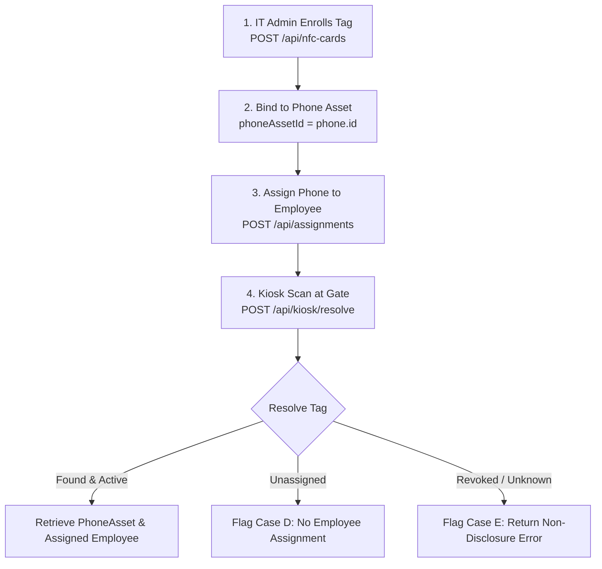

# NFC Phone Tag Specification & Asset Mapping Guide

**Document Version:** 1.0.0  
**Target Audience:** Hardware Engineers, IT Fleet Administrators, Depot Custodians  
**System:** Company Phone Tracker — Mobile Asset Custody Platform

---

## 1. Physical Tag Specifications & Mounting Guidelines

To track mobile assets via high-frequency contactless scanning, physical passive NFC tags are attached directly to each company-issued smartphone.

### Recommended Tag Hardware
* **Chip Type:** NXP NTAG213, NTAG215, or NTAG216 (ISO/IEC 14443 Type A, NFC Forum Type 2).
* **Form Factor:** Anti-Metal (Ferrite Shielded) Adhesive NFC Sticker (25mm to 30mm diameter).
* **Operating Frequency:** 13.56 MHz.
* **Surface Compatibility:** The anti-metal ferrite shielding layer is **mandatory**; standard NFC stickers applied directly to smartphone metal or battery surfaces will fail due to RF interference and eddy current absorption.

### Mounting & Tamper-Evident Procedures
1. **Surface Preparation:** Clean the lower third of the phone's rear glass/polycarbonate chassis using 70% Isopropyl Alcohol (IPA) to eliminate oils and dirt.
2. **Placement Zone:** Position the tag on the **lower rear** of the device, away from the smartphone's internal NFC loop (usually located near the camera bump or top edge) to prevent cross-talk during internal phone usage.
3. **Protective Enclosure:** Install a high-durability, clear polyurethane or shockproof case over the phone and tag. This protects the physical tag against abrasion, moisture, and intentional peeling.
4. **Tamper Detection:** Use destructible tamper-evident vinyl or polyester stickers that tear upon removal attempts. Any torn tag is immediately quarantined and re-enrolled under supervised IT clearance.

---

## 2. Identifier Normalization Engine

Unbranded USB NFC readers transmit card identifiers in multiple hardware-specific formats depending on firmware emulation modes:

```
[Raw Reader Input] ─────► [Normalization Engine] ─────► Standard Output
  • "04a28b7168"              (src/lib/nfc/normalization.ts)   • Normalized UID: "04:A2:8B:71:68"
  • "04:a2:8b:71:68"                                           • Specific Card No: "SN-04A28B7168"
  • "0114156366" (Decimal)                                     • Validated Bit Length: 32 / 56-bit
```

### Supported Ingestion Formats

| Source Mode | Sample Raw Input | Normalized `cardUid` | Standard `cardNumber` |
| :--- | :--- | :--- | :--- |
| **Colon-Separated Hex** | `04:a2:8b:71:68` | `04:A2:8B:71:68` | `SN-04A28B7168` |
| **Raw Unseparated Hex** | `04a28b7168` | `04:A2:8B:71:68` | `SN-04A28B7168` |
| **Mode A Keyboard Wedge (Dec)** | `0114156366` | `06:CD:DA:4E` | `SN-0114156366` |
| **Padded Decimal Stream** | `00114156366\r\n` | `06:CD:DA:4E` | `SN-0114156366` |

### Rapid Duplicate Suppression (Hardware Debouncing)
Physical taps frequently produce keystroke bouncing or accidental multi-tap triggers:
* An in-memory sliding window cache stores `(normalizedUid, lastScannedTimestamp)`.
* Scans occurring within **1,200ms** of an identical UID are immediately suppressed by the server without querying the database, returning `{ success: true, debounced: true }`.

---

## 3. Relational Mapping Workflow



### Initial Tag Enrollment
Administrators enroll tags via the web console (`/nfc-cards`) or the provisioning API:
```bash
POST /api/nfc-cards
Content-Type: application/json

{
  "cardUid": "04:A2:8B:71:68",
  "cardNumber": "SN-04A28B7168",
  "identifierType": "MIFARE_CLASSIC",
  "phoneAssetId": "4c94b3c0-3880-452f-bd99-73e4b09ff44b",
  "status": "ACTIVE"
}
```

---

## 4. Tag Replacement & Audit Lifecycle

When a physical phone tag is damaged, degraded, or peeled, it must be replaced using the supervised replacement workflow:

```bash
POST /api/nfc-cards/[id]/replace
Content-Type: application/json

{
  "newCardUid": "04:FF:88:99:11",
  "replacementReason": "DAMAGED",
  "remarks": "Tag degraded by chemical cleaning solvent during sanitization."
}
```

### Database Execution Guarantees
1. The old `NfcCard` record is atomically transitioned to `status: "DAMAGED"` or `"LOST"`, and its `phoneAssetId` is cleared.
2. A new `NfcCard` record is provisioned and bound to the `PhoneAsset`.
3. An immutable audit record is logged in `AuditLog` containing the old UID, new UID, replacement reason, and performing user.
4. Historical `CustodyTransaction` records retain links to the original tag ID for forensic continuity.
