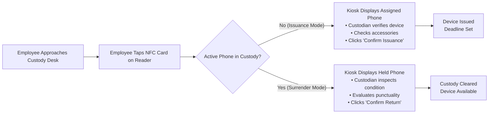

# Standard Operating Procedures & User Manual
## Company Phone Tracker (CPT) — Daily Operations & Kiosk Turnstile Guide

**Manual Version:** 1.0.0 (Release Candidate)  
**Date:** October 12, 2026  
**Primary Users:** Phone Custodians, Security Officers, Department Supervisors, Kiosk Operators  
**System Access:** `http://localhost:5000`  

---

## 1. Introduction & Operational Philosophy

The **Company Phone Tracker (CPT)** is an enterprise custody platform engineered to monitor company-issued smartphones with the turnstile speed of a modern attendance kiosk.

Every custody transfer (issuance or surrender) is verified through an employee's **NFC card tap**, authenticated by an on-duty **Phone Custodian**, and tracked in real time against shift schedules and return deadlines.

### Key Operational Rules:
1. **Never Hand Over a Phone Without an NFC Scan:** All checkouts must be recorded in the system.
2. **Physical Verification is Mandatory:** Always verify the employee's face against the photo on the kiosk screen before releasing a phone.
3. **Inspect Device Condition at Both Checkpoints:** Check the screen, chassis, and camera lens both at issuance and upon surrender.
4. **Report Damage Immediately:** If a phone is returned with physical damage, record the defect during the return flow to automatically generate an Incident Ticket (`INC-`).

---

## 2. Quick Reference Cheat Sheet

| Operational Step | Custodian Action | System Visual / Audio Feedback |
|---|---|---|
| **Card Tap** | Employee places NFC badge on reader | Beep + green glow; Employee profile loads |
| **Verify Identity** | Compare employee in person with screen photo | Employee Name, ID, and Department displayed |
| **Inspect Asset** | Match Asset Tag / IMEI with the physical phone | Device Model and serial number shown on screen |
| **Condition Check** | Note screen cracks, dents, or missing charger | Radio buttons for condition (Good / Fair / Poor) |
| **Confirm Action** | Click large blue button (`Confirm Issuance` or `Confirm Return`) | Success banner + turnstile sound; resets in 3s |

---

## 3. Getting Started & Logging In

1. Open Google Chrome or Microsoft Edge and navigate to `http://localhost:5000`.
2. Enter your assigned Custodian or Supervisor credentials:
   - **Phone Custodians:** `custodian@company.com` / `Custodian@123`
   - **Department Supervisors:** `supervisor@company.com` / `Supervisor@123`
   - **Administrators:** `admin@company.com` / `Admin@123`
3. Click **Sign In**.
4. Once authenticated, you will be directed to the **Operations Dashboard** or **NFC Kiosk**.

> [!IMPORTANT]
> Always lock your workstation or log out when stepping away from the custody desk. Your user account is stamped onto every custody transaction you authorize.

---

## 4. Single-Step Employee Registration with NFC Card Scan

To register a new employee and link their NFC badge in a single unified step:

1. In the left navigation menu, click **Employees** > **Add Employee**.
2. Fill in the required employee identity fields:
   - **First Name** (e.g., `Maria`)
   - **Last Name** (e.g., `Santos`)
   - **Department** (Select from dropdown: `Sales`, `Logistics`, `Field Support`, etc.)
   - **Position** (e.g., `Logistics Coordinator`)
3. Locate the **NFC Card Scan** panel on the right side of the form.
4. Ask the employee to tap their new NFC badge on the USB reader plate:
   - The reader will beep.
   - The card's unique 10-digit number (e.g., `0114156366`) will automatically populate into the **Card Identifier** input.
   - A green checkmark will appear: *"Card UID Verified & Ready for Enrollment"*.
5. (Optional) Assign a default company smartphone from the **Assigned Phone** selector.
6. Click **Save Employee**. The employee is now immediately eligible to check out phones at the kiosk.

---

## 5. Daily Phone Issuance Workflow (Step-by-Step)

The Issuance workflow is used at the start of an employee's shift.

1. Navigate to the **NFC Kiosk** (`/kiosk`) or click **Kiosk** in the top navigation.
2. Ensure the scan capture listener is active (look for the green pulsing dot: *"Scanner Ready"*).
3. **Step 1: Employee Taps Badge**
   - The employee places their NFC badge on the USB reader.
   - The kiosk turnstile immediately queries the database and recognizes the employee.
4. **Step 2: Custody Verification Screen Appears**
   - The screen switches to the **Issue Phone** confirmation panel.
   - The employee's name, ID number, and department are displayed prominently.
   - The system retrieves their pre-assigned smartphone (e.g., `Samsung Galaxy A54 - Asset Tag: MOB-001`).
5. **Step 3: Physical Device Verification**
   - Pick up the phone from the charging rack.
   - Verify the physical barcode/asset sticker matches the screen.
   - Check the physical condition (Screen, Camera, Casing).
   - Check accessory checkboxes: `[x] Protective Case`, `[x] USB Cable`, `[x] Power Adapter`.
6. **Step 4: Review Return Deadline**
   - The system automatically displays the computed return deadline (e.g., `Today, 5:00 PM (Manila Time)`), including the 15-minute grace period.
7. **Step 5: Confirm Issuance**
   - Click the green **Confirm Issuance** button.
   - A success sound plays and a green banner confirms: *"Phone MOB-001 successfully issued to Maria Santos."*
   - Hand the device to the employee. The screen automatically resets after 3 seconds for the next person in line.

---

## 6. Daily Phone Surrender Workflow (Step-by-Step)

The Surrender workflow is used at the end of an employee's shift.

1. On the **NFC Kiosk** screen, have the returning employee tap their NFC badge.
2. The turnstile detects that this employee currently holds an open custody record and automatically switches to **Return Phone Mode**.
3. **Step 1: Inspect the Device**
   - Take the phone and accessories from the employee.
   - Inspect the glass display for new cracks or scratches.
   - Check battery level and verify device powers on.
4. **Step 2: Condition & Damage Assessment**
   - Select the device condition upon return:
     - `Good` — Normal wear and tear, clean, operational.
     - `Fair` — Minor scuffs, fully operational.
     - `Damaged` — Cracked screen, broken camera, or non-functional ports.
5. **Step 3: Automated Incident Reporting (For Damaged Assets)**
   - If you select `Damaged`, an Incident description box expands automatically.
   - Enter a brief note: e.g., *"Dropped during field shift; screen glass cracked near top right corner."*
   - The system will automatically create an **Incident Ticket** (`INC-XXXX`) and flag the phone for IT maintenance upon submission.
6. **Step 4: Punctuality Evaluation**
   - The screen shows whether the return is **On Time** or **Overdue**.
   - If overdue, the recorded overdue duration is logged.
7. **Step 5: Confirm Return**
   - Click the blue **Confirm Return** button.
   - A confirmation banner appears: *"Phone MOB-001 returned successfully. Custody cleared."*
   - Place the phone in the charging bay. The kiosk resets for the next employee.

---

## 7. Active Custody Monitoring & Real-Time Tracking

To see all company phones currently checked out in the field:

1. Click **Active Custody** in the left sidebar.
2. The live dashboard displays a real-time table of all outstanding devices:
   - **Employee Name & Department**
   - **Device Model & Asset ID**
   - **Issuing Custodian**
   - **Time Checked Out**
   - **Due Time & Remaining Time Countdown**
   - **Status Badge:** `ACTIVE` (Green) or `OVERDUE` (Red pulsing)
3. Use the department filter dropdown to view specific teams (e.g., *"Show only Field Logistics"*).
4. Click on any row to view full transaction lineage, accessories issued, and shift details.

---

## 8. Overdue Monitoring & Supervisor Approvals

When an employee does not return their phone before their shift deadline plus grace period, the autonomous background worker creates an **Overdue Case**.

### How Department Supervisors Handle Overdue Cases:
1. Navigate to **Overdue Cases** in the sidebar.
2. Review the list of delinquent devices. Overdue cases are color-coded by severity:
   - `Tier 0 (Grace Period)`: 0–15 mins overdue.
   - `Tier 1 (First Warning)`: 15–60 mins overdue (Employee notified).
   - `Tier 2 (Escalated)`: 1–2 hours overdue (Supervisor notified).
   - `Tier 3 (Critical)`: >4 hours overdue (Security & Admin notified).
3. **Granting an Approved Extension (Overtime / Shift Extension):**
   - If the employee was authorized for overtime, click **Grant Extension**.
   - Select the new extended return time (e.g. +2 hours).
   - Enter the business justification: e.g., *"Authorized client emergency service call in Quezon City."*
   - Click **Save Extension**.
   - The overdue flag is temporarily cleared, and the audit log records the supervisor's approval.

---

## 9. Incident Ticket Reporting & Asset Damage Lifecycle

When a device is damaged, lost, or malfunctioning:

1. Navigate to **Incident Management** > **Report Incident**.
2. Select the affected **Phone Asset** and the **Employee** involved.
3. Select the Incident Type:
   - `Physical Damage (Screen / Chassis)`
   - `Water / Liquid Damage`
   - `Lost / Unaccounted Asset`
   - `Malfunctioning Battery / Software Fault`
4. Enter detailed observations and upload photos if available.
5. Click **Submit Ticket**.
6. The phone's inventory status is immediately updated to `UNDER_MAINTENANCE` or `REPORTED_LOST`, preventing it from being issued to anyone else at the kiosk until IT clears the ticket.

---

## 10. Frequently Asked Questions (FAQ)

**Q: What if the employee forgot their NFC card at home?**  
A: A custodian can use the **Manual Custody Checkout** feature in the administrative menu. Search for the employee by name or ID, enter your custodian password, and select the device manually. This action is flagged in the audit log as a manual override.

**Q: Can one employee check out two phones at the same time?**  
A: By default, the system restricts employees to one active phone. If a technician requires a secondary testing phone, an administrator or supervisor must enable the *"Multi-Device Authorized"* toggle on the employee profile.

**Q: What happens if an employee leaves the company with a phone?**  
A: The system's **Controlled Clearance Guard** prevents HR or administrators from deactivating or terminating an employee record as long as an active phone custody transaction exists. The phone must be returned or formally marked as `LOST` with an incident ticket before HR clearance can proceed.
